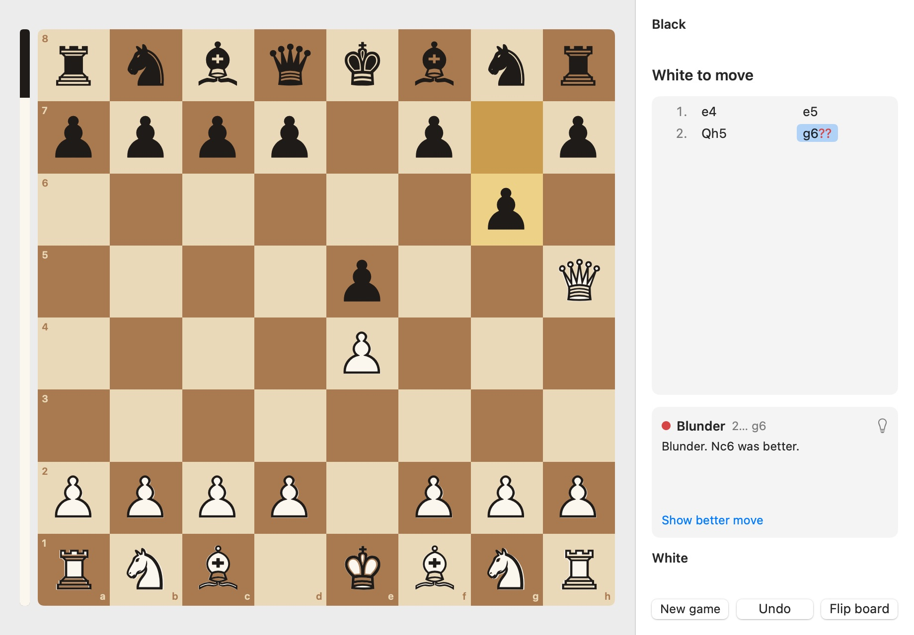
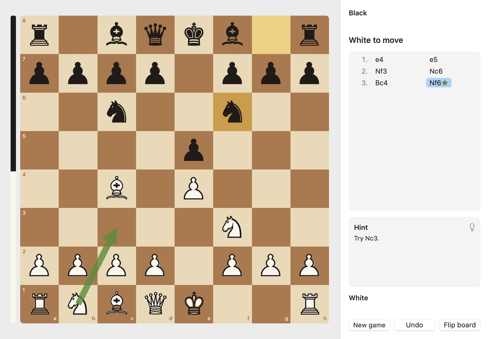
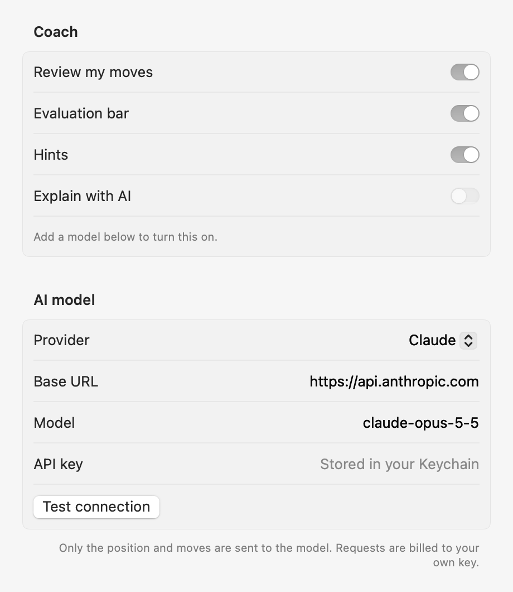

<p align="center">
  
</p>

<h1 align="center">Chess AI</h1>

<p align="center">
  <b>A native chess app for macOS that coaches you on every move.</b><br>
  A built-in engine grades each move from Best to Blunder. The AI model you choose explains why, or plays against you.
</p>

<p align="center">
  <a href="https://chess-for-mac.vercel.app"><b>Website</b></a> ·
  <a href="https://github.com/OpenVibes/chess-ai/releases/latest"><b>Download for Mac</b></a> ·
  <a href="#build-from-source">Build from source</a>
</p>

<p align="center">
  
</p>

## Why

Playing a computer tells you that you lost. It rarely tells you *which* move lost it, or why. Chess AI reviews every move you make, as you make it:

- **The engine judges.** A built-in alpha-beta engine compares your move with its best move and grades it by how much winning chance you gave away: Best ★, Excellent !, Good, Inaccuracy ?!, Mistake ?, Blunder ??.
- **Your AI explains.** Turn on *Explain with AI* and the model you pick gets the engine's verdict, the better move and the line, then explains it in two plain sentences. It explains; it never overrules the engine.
- **Hints when you're stuck.** The lightbulb (⇧⌘H) draws an arrow for the best move, and an evaluation bar beside the board shows who is ahead.

Grades, hints and the evaluation bar work offline with no API key.

## Features

| | |
|---|---|
| **Three ways to play** | Two players on one Mac, versus the built-in computer (Easy, Medium, Hard), or **versus an AI model** |
| **Move coach** | Every move graded, marked in the move list, and explained on request. Click any past move to see its review again |
| **Bring your own model** | Claude, OpenAI, Gemini, OpenRouter, Ollama on your Mac, or any proxy that speaks the Anthropic or OpenAI format |
| **Full rules** | Castling, en passant, promotion, check, checkmate, stalemate, fifty moves, threefold repetition, insufficient material |
| **Native and small** | SwiftUI, under 1 MB, light and dark mode, no dependencies |

<p align="center">
  
  
</p>

### Versus AI model

Pick a provider, a model and a colour right in the **New game** sheet: **Choose** lists the models your server offers (for Ollama, the ones you have pulled), and the same sheet turns the coach and *Explain my mistakes with AI* on or off. On its turn the app sends the position (FEN), the moves so far and the full list of legal moves, and asks for a reply ending in `MOVE: <san>`. If the model answers with an illegal or unreadable move it gets two more tries; after that the engine plays that one move for it and the app tells you so. Network or key errors pause the game with **Try again** and **Let the engine move**.

### Privacy

- Your API key is kept in the macOS Keychain, never in files or logs.
- Only the position and the moves are sent, straight from your Mac to the provider you chose. Requests are billed to your own key.
- No account, no analytics.

## Install

1. Download `Chess-1.2.0.dmg` from the [latest release](https://github.com/OpenVibes/chess-ai/releases/latest) or the [website](https://chess-for-mac.vercel.app/#download).
2. Open it and drag **Chess** into **Applications**.
3. The app is ad-hoc signed, not notarised, so macOS blocks the first launch. Open **System Settings → Privacy & Security** and click **Open Anyway**, or run once:
   ```bash
   xattr -dr com.apple.quarantine /Applications/Chess.app
   ```
4. For AI features, open **Chess → Settings** (⌘,), pick a provider, paste a key and press **Test connection**.

Requires macOS 14 or later on Apple silicon.

## Build from source

Needs Xcode 16 or later (Swift 6 toolchain). It is a plain Swift package: no Xcode project.

```bash
git clone https://github.com/OpenVibes/chess-ai.git
cd chess-ai
swift run ChessApp      # debug build, launches the app
swift test              # 183 tests: perft, engine, coach, app model
./build.sh              # dist/Chess.app and dist/Chess-<version>.dmg (icon step needs Pillow)
```

## How it works

```
ChessApp  ──▶  ChessCoach  ──▶  ChessEngine  ──▶  ChessCore
SwiftUI        grading, LLM      alpha-beta        rules, FEN,
window         client, prompts   search, eval      SAN, perft
```

| Module | What it does |
|---|---|
| `ChessCore` | Bitboard positions, legal move generation with pin and check masks, FEN, SAN, game status and draws. Verified with perft against the standard reference counts. |
| `ChessEngine` | Negamax with alpha-beta, PVS, iterative deepening, quiescence search, MVV-LVA, killer and history ordering, piece-square evaluation. `Engine.analyse` returns the best move, score and line. |
| `ChessCoach` | Turns two analyses into a grade using a win-chance curve, writes the rule-based summary, and talks to models in the Anthropic Messages or OpenAI Chat Completions format. Parses the model's move from free text. |
| `ChessApp` | The window, board, sidebar, coach card, evaluation bar, settings and Keychain storage. Analysis runs in the background and is cancelled whenever the position changes. |

More detail: [`docs/SPEC.md`](docs/SPEC.md) (API contract and design), [`filemap.md`](filemap.md) (where things live).

### Headless screenshots

The app can render its own window to a PNG without screen-recording permission, which is how the screenshots here were made:

```bash
CHESS_SNAPSHOT=$PWD/shot.png CHESS_COACH_DEMO=1 CHESS_MOVES="e2e4 e7e5 d1h5 g7g6" .build/debug/ChessApp
```

See [`CLAUDE.md`](CLAUDE.md) for all the `CHESS_*` switches.

## Website

The landing page lives in [`website/`](website) (one static HTML file) and is deployed to Vercel: **[chess-for-mac.vercel.app](https://chess-for-mac.vercel.app)**. It includes a playable "what would you play?" position graded by this engine.

## License

[MIT](LICENSE)

Not affiliated with Anthropic, OpenAI, Google, OpenRouter or Ollama. Model and product names belong to their owners.
